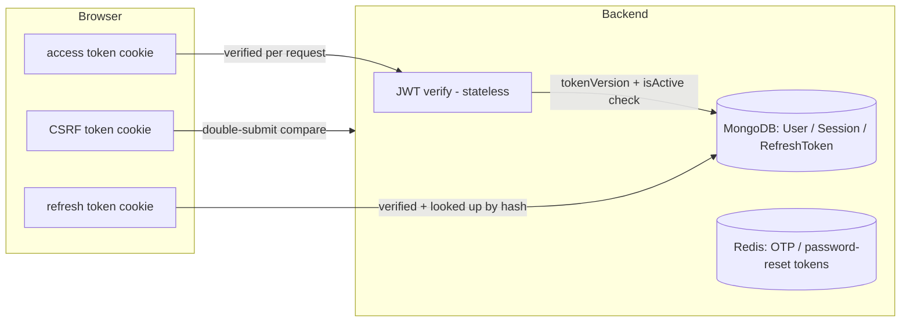
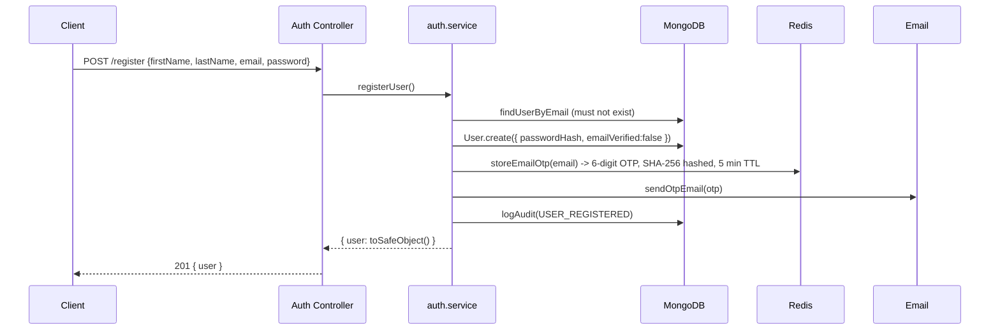
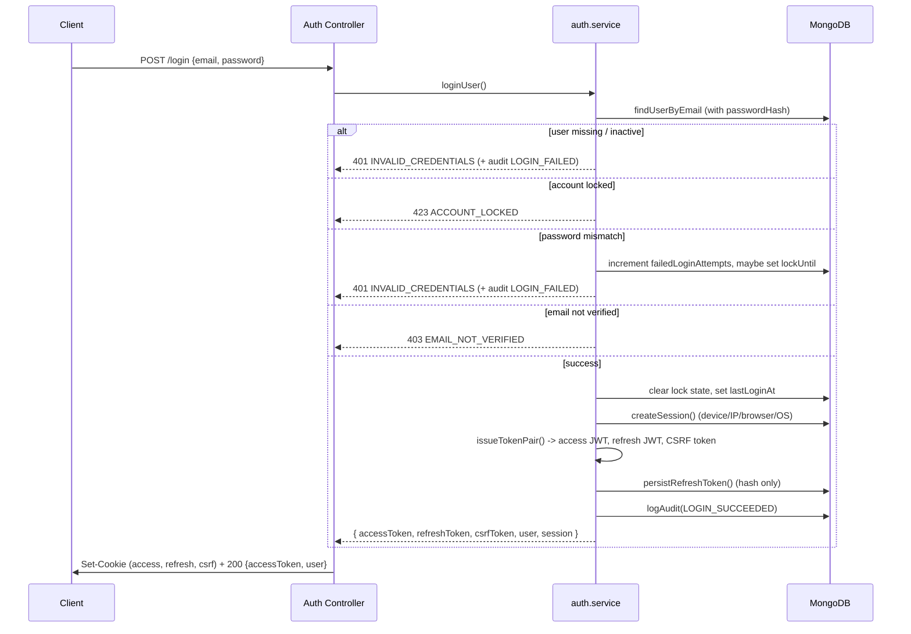
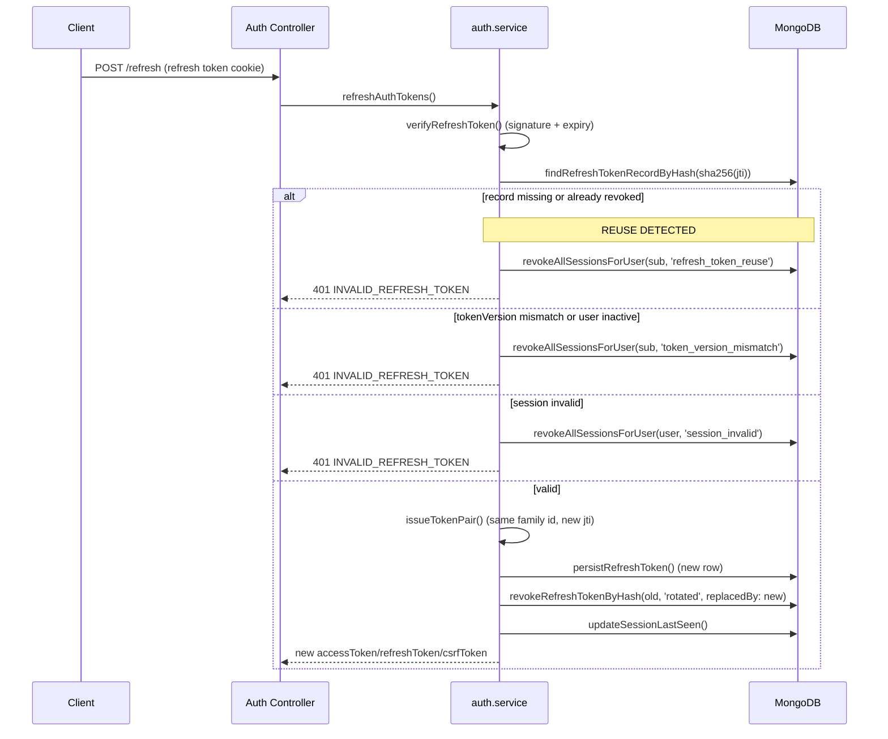
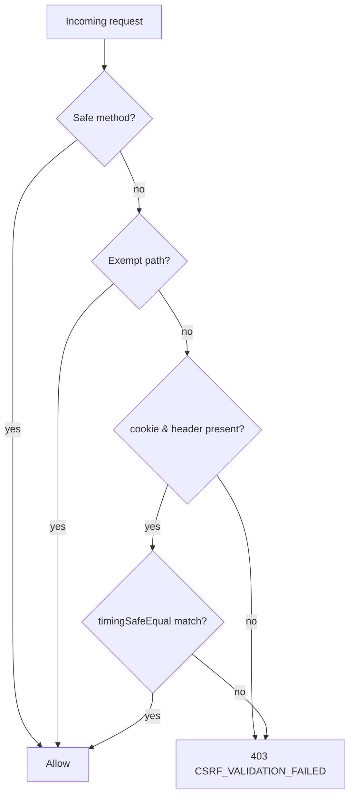
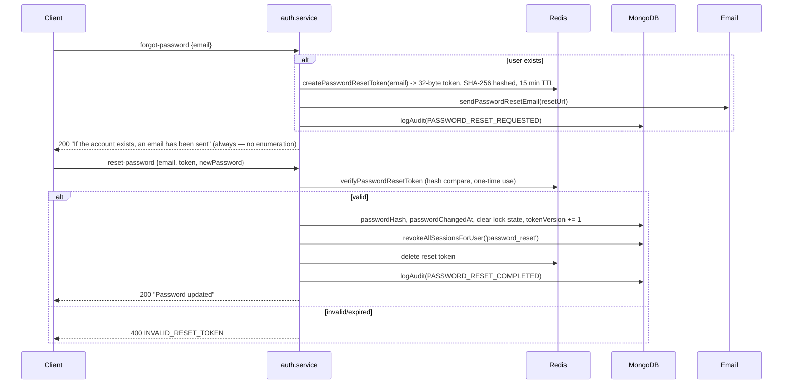

# Sync OS — Authentication System

This document explains how authentication works in Sync OS end to end: registration, OTP
verification, login, token issuance and rotation, session/device tracking, logout, password
reset, and the security controls wrapped around all of it (CSRF, rate limiting, account
lockout, audit logging).

It is written so a new backend engineer can understand the whole system without reading the
implementation first.

---

## 1. Mental model

Sync OS authentication is **stateless at the HTTP layer, stateful at the database layer**:

- The browser holds three `httpOnly` cookies (access token, refresh token, CSRF token — the
  CSRF cookie is the one exception, see §9) and nothing else.
- Every access token is a short-lived JWT. It is *not* looked up in a database on every
  request beyond a cheap `User.findById` — but it *is* checked against two server-side
  invariants (`isActive`, `tokenVersion`) that let the server invalidate it at any time even
  though the JWT itself is technically still valid until it expires.
- Every refresh token is backed by a persisted row (`RefreshToken` in MongoDB) and a parent
  `Session` row. The JWT is the credential; the database row is the source of truth for
  whether that credential is still alive. This is what makes rotation, reuse-detection, and
  "logout this device" / "logout everywhere" possible.



---

## 2. Register flow

**Endpoint:** `POST /api/v1/auth/register` (rate-limited: `authLimiter`, 10 req / 15 min)



Key points:

- Password is hashed with **bcrypt, 12 salt rounds** before it ever touches the database.
- The user document is created with `emailVerified: false` and `organization: null`. The
  account exists but cannot log in yet (see §3) and does not belong to any tenant yet — that
  happens during onboarding (`docs/rbac-multi-tenant-architecture.md`, §5).
- The OTP itself is never stored in plaintext — only its SHA-256 hash, in Redis, with a TTL.
  Even a full Redis dump does not reveal valid OTPs.
- Duplicate-email registration is rejected with `409 EMAIL_EXISTS` (no information about
  *why* beyond that — avoids leaking which fields matched).

## 3. Email OTP verification

**Endpoint:** `POST /api/v1/auth/verify-email` (rate-limited: `otpLimiter`, 5 req / 15 min)
**Endpoint:** `POST /api/v1/auth/resend-otp` (same limiter)

- `verifyEmailWithOtp(email, otp)` hashes the submitted OTP and compares it to the value
  stored in Redis under `sync:email-otp:<email>`.
- On match: the Redis key is deleted (one-time use), `user.emailVerified = true` and
  `emailVerifiedAt` is set.
- On mismatch or expiry: `400 INVALID_OTP`-style error; the rate limiter is what stops brute
  forcing the 6-digit space (1,000,000 combinations / 5-per-15-min window is computationally
  infeasible within the 5-minute OTP TTL).
- `resend-otp` invalidates any existing OTP and issues a new one — it does **not** extend the
  original TTL or allow stacking multiple valid OTPs.

A user **cannot log in** until `emailVerified === true` (enforced in the login flow, §4).

## 4. Login flow

**Endpoint:** `POST /api/v1/auth/login` (rate-limited: `authLimiter`, 10 req / 15 min)



Login is the single point where a **Session** row and a **RefreshToken** row are created
together — see §8/§9 for what these represent.

## 5. Access tokens

- Signed JWT (`HS256`, secret `JWT_SECRET`), TTL **15 minutes** (`JWT_ACCESS_EXPIRES_IN`).
- Payload: `{ sub: userId, sid: sessionId, tv: user.tokenVersion, role: user.role }`.
- Verified on every protected request by `middlewares/authenticate.js`:
  1. Read from the `httpOnly` cookie (`AUTH_ACCESS_COOKIE_NAME`) or `Authorization: Bearer`
     header (cookie takes priority).
  2. `jwt.verify()` — rejects expired/tampered tokens immediately.
  3. **Live invariant check**: `user.isActive` must still be `true` and `user.tokenVersion`
     must still equal the token's `tv` claim. This is what lets the server kill an access
     token *before* its 15-minute expiry — e.g. after a password reset or "logout everywhere"
     — without needing a token blocklist.
- On success, `req.user` (full Mongoose doc), `req.auth` (decoded JWT), and `req.sessionId`
  are attached for downstream middleware/controllers.

## 6. Refresh tokens

- Signed JWT (`HS256`, secret `JWT_REFRESH_SECRET`, **different secret from the access
  token** so a leaked access-token secret can't be used to mint refresh tokens), TTL
  **7 days** (`JWT_REFRESH_EXPIRES_IN`).
- Payload: `{ sub, sid, tv, fam: tokenFamilyId }`, with a `jti` (JWT ID) set via
  `jwt.sign(..., { jwtid })`.
- The refresh JWT itself is **not** the sole credential. Its `jti` is hashed (SHA-256) and
  stored in a `RefreshToken` Mongo document (`jtiHash`, unique-indexed) linked to a `Session`.
  Possessing a syntactically valid, unexpired refresh JWT is not enough — the corresponding
  `RefreshToken` row must also exist and be unrevoked.
- A `tokenFamilyId` ties together every refresh token ever issued from the same original
  login — this is the mechanism behind reuse detection (§7).

## 7. Refresh rotation (and reuse detection)

**Endpoint:** `POST /api/v1/auth/refresh` (CSRF-exempt — see §10; rate-limited by `apiLimiter`
globally)

Every refresh **consumes** the old refresh token and issues a brand new one. The old token's
`RefreshToken` row is marked `revokedAt` / `revokedReason: 'rotated'` and linked via
`replacedByJtiHash` to its successor — a full forward chain is preserved for audit.



**Why this matters:** if an attacker steals a refresh token and uses it, the legitimate
user's *next* refresh attempt will present a token that has already been rotated away
(`revokedAt` is set) — that's detected as reuse, and the server responds by revoking **every**
session for that user, forcing a full re-login everywhere. This bounds the damage of a single
stolen refresh token to "one extra refresh cycle," not "permanent account takeover."

## 8. Redis sessions vs. Mongo sessions — an important distinction

Sync OS uses Redis for two unrelated things, and it is worth being explicit about which is
which:

| Mechanism | Storage | Purpose |
|---|---|---|
| **OTP codes** | Redis, `sync:email-otp:<email>`, 5 min TTL | Email verification |
| **Password reset tokens** | Redis, `sync:password-reset:<email>`, 15 min TTL | Forgot-password flow |
| **"Session" (device/login session)** | **MongoDB**, `Session` collection | Device tracking, "active sessions" list, logout-this-device, logout-everywhere |

There is **no** `express-session` / Redis-backed HTTP session layer in this codebase — an
earlier scaffold (`connect-redis` + `express-session`) existed but was unused (nothing ever
wrote to `req.session` except destroying it on logout) and has since been removed. All
"session" behavior that matters for auth — device list, revocation, rotation — is implemented
explicitly via the `Session` and `RefreshToken` Mongo models described above, not via a
generic session middleware.

## 9. Session tracking & device tracking

Every successful login creates one `Session` document:

```js
Session {
  user, refreshToken, refreshTokenHash,
  deviceName,      // "Chrome on macOS"
  browser, os, deviceType,   // parsed from User-Agent
  ipAddress,
  isActive, revokedAt, revokedReason,
  lastSeenAt,
  expiresAt,       // TTL-indexed, auto-pruned by MongoDB
}
```

Device/browser/OS are parsed from the `User-Agent` header by `utils/device.js` (simple
regex-based detection — Chrome/Edge/Firefox/Safari/Opera, Windows/macOS/Linux/Android/iOS,
mobile vs. desktop). IP address is taken from `X-Forwarded-For` (first hop) → `req.ip` →
socket address, in that priority order.

Endpoints built on top of this:

- `GET /api/v1/auth/sessions` — list all sessions for the current user (most-recently-seen
  first), so a user can see "where am I logged in."
- `DELETE /api/v1/auth/sessions/:sessionId` — revoke one specific device/session
  (`logout_current`-style, but targeted).
- `POST /api/v1/auth/logout-all` — revoke every session (see §13).

`Session.expiresAt` has a Mongo TTL index (`expireAfterSeconds: 0`), so stale sessions are
garbage-collected by MongoDB itself rather than requiring a cron job.

## 10. HTTP-only cookies

Three cookies are set on login/refresh (`utils/cookies.js`):

| Cookie | `httpOnly` | `secure` | `sameSite` | Max-Age | Purpose |
|---|---|---|---|---|---|
| Access token (`AUTH_ACCESS_COOKIE_NAME`) | ✅ | prod only | `lax` | 15 min | Auth on every request |
| Refresh token (`AUTH_REFRESH_COOKIE_NAME`) | ✅ | prod only | `lax` | 7 days | Token rotation |
| CSRF token (`AUTH_CSRF_COOKIE_NAME`) | ❌ (deliberately) | prod only | `lax` | 7 days | Double-submit CSRF defense |

The CSRF cookie is intentionally **not** `httpOnly` — client-side JS must be able to read it
to echo it back as a request header (see §11). This is the standard "double-submit cookie"
pattern and is safe specifically *because* CSRF is about a third-party site making the
browser send a request, not about XSS reading cookies — `httpOnly` defends against a
different threat (XSS token theft), which is why the access/refresh tokens stay `httpOnly`
while the CSRF token does not.

## 11. CSRF protection

`middlewares/csrf.middleware.js`, applied **globally** in `app.js` (`app.use(csrfProtection)`)
— there is a single enforcement point, not one per route.

- **Safe methods** (`GET`, `HEAD`, `OPTIONS`) are always allowed through.
- A fixed allowlist of **exempt paths** bypasses CSRF entirely — these are endpoints that are
  either unauthenticated by design (register, login, OTP verify/resend, forgot/reset
  password, invite-accept) or are themselves how a client *obtains* a CSRF token
  (`GET /auth/csrf-token`, which is also a safe `GET` anyway), plus `/health`. Matching is
  **exact-path or path-prefix-with-a-slash-boundary** (`pathname === path ||
  pathname.startsWith(path + '/')`) specifically so a future route like
  `/api/v1/auth/login-as-someone-else` can never accidentally inherit an exemption meant for
  `/api/v1/auth/login`.
- For everything else: the request must carry **both** the `sync_csrf_token` cookie **and**
  an `X-CSRF-Token` (or `X-XSRF-Token`) header, and the two must match via a **timing-safe
  comparison** (`crypto.timingSafeEqual`, length-checked first) — not a plain `===`, which
  would leak timing information about how many leading characters matched.



A fresh CSRF token+cookie pair is also reissued as part of every successful login/refresh, so
the client always has a current token to echo back without an extra round trip in the common
case.

## 12. Rate limiting

`middlewares/rate-limit.middleware.js`, all windows are 15 minutes:

| Limiter | Limit | Applied to |
|---|---|---|
| `authLimiter` | 10 req | `/register`, `/login` |
| `otpLimiter` | 5 req | `/verify-email`, `/resend-otp` |
| `passwordResetLimiter` | 5 req | `/forgot-password`, `/reset-password` |
| `apiLimiter` | 300 req | every request (applied globally in `app.js`, ahead of CSRF) |

The tight `otpLimiter`/`passwordResetLimiter` windows are what make a 6-digit OTP and a
32-byte reset token brute-force-infeasible within their respective TTLs, independent of how
strong the underlying secret is.

## 13. Account lockout

Tracked directly on the `User` document: `failedLoginAttempts`, `lockUntil`.

- Threshold: **5 failed attempts** (`ACCOUNT_LOCK_ATTEMPTS`).
- Lock duration: **15 minutes** (`ACCOUNT_LOCK_DURATION_MS`) from the 5th failure.
- `user.isLocked()` checks `lockUntil > now`.
- A successful login, or a successful password reset, clears `failedLoginAttempts` and
  `lockUntil` back to zero/null.
- While locked, login returns `423 ACCOUNT_LOCKED` regardless of whether the password
  supplied would otherwise have been correct — this avoids leaking "your password is right,
  you're just locked out" vs. "wrong password" as distinguishable signals during a lockout
  window.

## 14. Forgot password flow

**Endpoints:** `POST /api/v1/auth/forgot-password`, `POST /api/v1/auth/reset-password`
(both `passwordResetLimiter`)



Two deliberate anti-enumeration choices: (1) `forgot-password` returns the same success
message whether or not the email exists, and (2) it never reveals *which* part of a
reset-password request was wrong. The `tokenVersion += 1` on completion immediately
invalidates every access token and refresh token issued before the reset — even ones with
time left on their TTL — exactly the same mechanism used by §15/§16.

## 15. Logout flow (current device)

**Endpoint:** `POST /api/v1/auth/logout` (CSRF-exempt at the route level is *not* applied —
this endpoint is reachable by an authenticated browser presenting valid cookies, and global
CSRF protection still applies to it like any other mutating request)

- Decodes whatever access/refresh tokens are present (best-effort — doesn't fail if one is
  already expired/garbled).
- Revokes the specific `RefreshToken` row (`logout_current`) and the specific `Session`
  (`logout_current`).
- Clears all three auth cookies.
- This is **single-device** logout — other active sessions for the same user are untouched.

## 16. Logout-all-devices flow

**Endpoint:** `POST /api/v1/auth/logout-all` (requires `authenticate`)

- Increments `user.tokenVersion` — this alone immediately invalidates every access token for
  every device, since `authenticate` checks `tokenVersion` equality on every request.
- Calls `revokeAllSessionsForUser(user._id, 'logout_all')`, which revokes every active
  `Session` and cascades to revoke every linked, not-yet-revoked `RefreshToken`.
- Clears cookies for the calling device and logs `LOGOUT_ALL`.

This is the same "nuke everything" mechanism used automatically by reuse-detection (§7) and
password reset (§14) — `logout-all` is just the user-initiated version of it.

## 17. Audit logs

Every security-relevant action writes an `AuditLog` document (`services/audit.service.js`):

```js
AuditLog {
  organization,   // nullable — null for pre-org-membership actions (register, login, etc.)
  user,           // actor, nullable for failed-auth-before-identity-known cases
  action,         // e.g. "auth.login_succeeded" — see constants/audit.constants.js
  entityType, entityId,
  success,
  metadata,       // free-form context (email, sessionId, failedLoginAttempts, ...)
  ipAddress, userAgent,
  createdAt,
}
```

Auth-related events currently logged: `USER_REGISTERED`, `EMAIL_OTP_SENT`/`VERIFIED`,
`LOGIN_SUCCEEDED`/`LOGIN_FAILED`, `TOKEN_REFRESHED`, `LOGOUT_CURRENT`/`LOGOUT_ALL`,
`SESSION_REVOKED`, `PASSWORD_RESET_REQUESTED`/`COMPLETED`. (RBAC/org events are documented
separately in `rbac-multi-tenant-architecture.md`.)

Audit logs are write-only from the auth flows themselves; they are read back via the
organization-scoped audit viewer (`GET /api/v1/audit-logs`, ORG_ADMIN-only — see the RBAC
doc) once a user belongs to an organization. Logs created before a user has an organization
(registration, pre-onboarding login attempts) simply have `organization: null` and are not
visible through that viewer — this is intentional, not a gap, since there is no tenant to
scope them to yet.

## 18. Security considerations / threat model summary

| Threat | Mitigation |
|---|---|
| Stolen access token (XSS) | `httpOnly` cookie, 15-min TTL, `tokenVersion` kill-switch |
| Stolen refresh token | Rotation + reuse detection revokes *all* sessions on detected reuse |
| CSRF | Double-submit cookie pattern, timing-safe compare, global enforcement |
| Brute-force login | Account lockout (5 attempts / 15 min) + `authLimiter` |
| Brute-force OTP | 6-digit space bounded by 5-req/15-min limiter within a 5-min TTL |
| Brute-force reset token | 32-byte random token, 5-req/15-min limiter, 15-min TTL, one-time use |
| Credential stuffing / general abuse | Global `apiLimiter` (300 req/15 min) ahead of all routes |
| Email enumeration | Forgot-password always returns the same message |
| Timing side-channels on token compare | `crypto.timingSafeEqual` for CSRF and OTP/reset-token hash comparisons |
| Password storage compromise | bcrypt, 12 rounds — never plaintext, never reversible |
| Cross-tenant data access | Out of scope for this document — see `rbac-multi-tenant-architecture.md` §6–7 |

**What this system deliberately does not do (yet):** no MFA/TOTP beyond email OTP at signup,
no anomaly-based login detection (impossible-travel, new-device email alerts), no IP
allowlisting/denylisting, no JWT key rotation tooling. These are reasonable next steps but are
not implemented as of this document.
