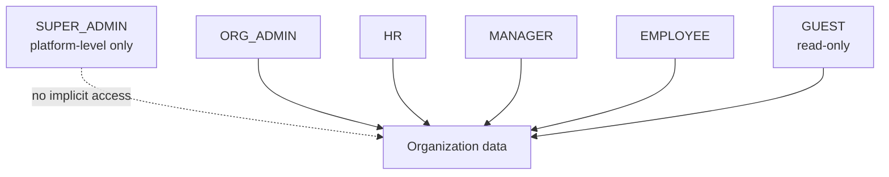
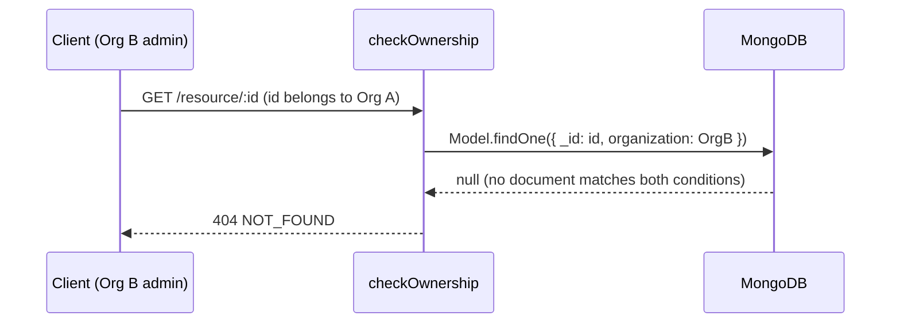
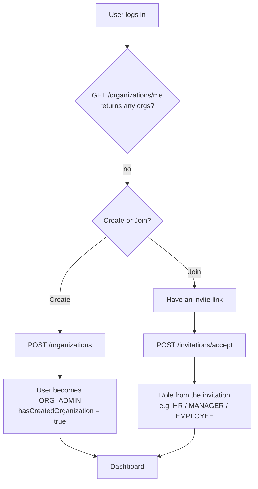
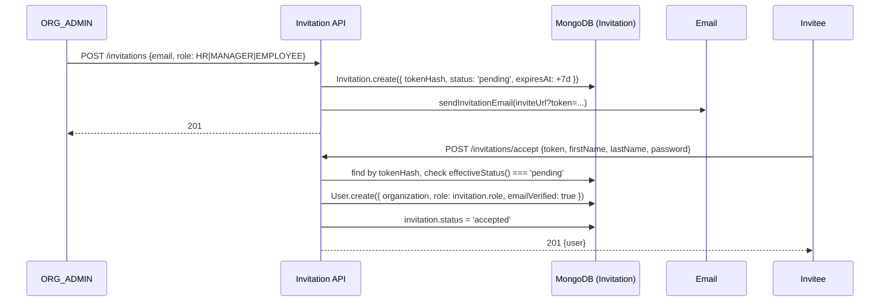
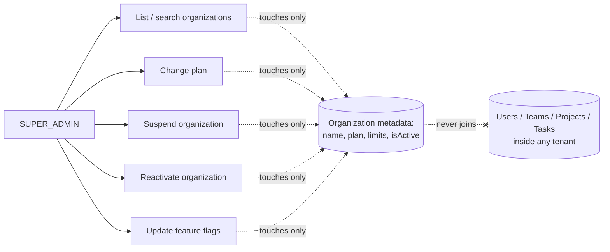

# Sync OS — RBAC & Multi-Tenant Architecture

This document explains how Sync OS isolates organizations from each other and controls what
each role inside an organization is allowed to do. It assumes you have read
`auth-system.md` for how a user authenticates in the first place — this document picks up
from "we know who `req.user` is" and covers everything about "what can `req.user` see and
do."

---

## 1. Philosophy

> Everything belongs to an organization. No organization should ever access another
> organization's data.

```
Organization
│
├── Users
├── Teams
├── Projects        (future)
├── Tasks            (future)
├── Meetings         (future)
├── Documents        (future)
├── Goals            (future)
└── Assets           (future)
```

Two architectural rules fall directly out of this philosophy and are enforced everywhere in
the codebase, not just documented:

1. **Every tenant-scoped model has an `organization` field.** `User`, `Team`, `AuditLog`,
   `Invitation` all carry it today; every future resource (Project, Task, Meeting, ...) must
   too.
2. **Permission logic never lives in controllers.** It lives in `middlewares/` (route-level
   gates) and `utils/` (ownership predicates used inside services). Controllers stay thin:
   parse request → call service → shape response.

## 2. Organization model

```js
Organization {
  name, slug,                 // slug is unique, used in URLs/branding
  logo,
  plan,                       // 'free' | 'starter' | 'pro' | 'enterprise'
  limits: { seats, aiCredits, storageGB },   // ceilings, not yet enforced anywhere
  featureFlags: {},           // per-org flag overrides, free-form
  settings: {},               // free-form org settings
  createdBy,                  // the user who created it (becomes ORG_ADMIN)
  isActive, suspendedAt, suspendedReason,    // platform-admin suspension (§12)
}
```

`limits` and `featureFlags` exist today purely as **shape for future billing/feature-gating
work** — nothing in the codebase currently enforces a seat limit or checks a feature flag.
They are there so that when that logic is built, it has somewhere to read from without a
schema migration.

## 3. Team model

```js
Team {
  organization,    // every Team belongs to exactly one Organization
  name, description,
  lead,            // User
  members: [User],
}
```

Teams are a sub-grouping *within* an organization (not a tenant boundary themselves). A
`User.team` field links a user to at most one team today.

## 4. Role hierarchy

```
SUPER_ADMIN   — platform operator. Manages Organizations themselves
                (plan, suspension, feature flags). Does NOT automatically
                get access to any organization's data.
ORG_ADMIN     — manages everything inside their own organization.
HR            — manages employees (not managers/admins/other HR).
MANAGER       — manages projects/tasks/meetings/teams inside the org.
EMPLOYEE      — edits only what's assigned to them; uploads documents.
GUEST         — read-only: documents, meetings, tasks. Never write access.
```



The dotted line is deliberate: `SUPER_ADMIN` is drawn *outside* the organization-data box.
This is enforced in code, not just in this diagram — see §5.

## 5. Permission matrix

Permissions are flat string constants (`constants/permissions.js`):

```
CREATE_PROJECT, UPDATE_PROJECT, DELETE_PROJECT
CREATE_TASK, UPDATE_TASK, DELETE_TASK, ASSIGN_TASK
CREATE_MEETING, UPDATE_MEETING
UPLOAD_DOCUMENT
VIEW_ANALYTICS
MANAGE_USERS
MANAGE_AI
CREATE_TEAM, UPDATE_TEAM
MANAGE_ASSETS
VIEW_DOCUMENT, VIEW_MEETING, VIEW_TASK
```

`constants/rolePermissions.js` maps each role to its permission set:

| Permission | SUPER_ADMIN | ORG_ADMIN | HR | MANAGER | EMPLOYEE | GUEST |
|---|:-:|:-:|:-:|:-:|:-:|:-:|
| CREATE/UPDATE/DELETE_PROJECT | – | ✅ | – | ✅ | – | – |
| CREATE/UPDATE/DELETE/ASSIGN_TASK | – | ✅ | – | ✅ | UPDATE only | – |
| CREATE/UPDATE_MEETING | – | ✅ | – | ✅ | – | – |
| UPLOAD_DOCUMENT | – | ✅ | ✅ | ✅ | ✅ | – |
| VIEW_ANALYTICS | – | ✅ | ✅ | ✅ | – | – |
| MANAGE_USERS | – | ✅ | ✅ | – | – | – |
| MANAGE_AI | – | ✅ | – | – | – | – |
| CREATE/UPDATE_TEAM | – | ✅ | ✅ | ✅ | – | – |
| MANAGE_ASSETS | – | ✅ | – | ✅ | – | – |
| VIEW_DOCUMENT / VIEW_MEETING / VIEW_TASK | – | ✅ | ✅ | ✅ | ✅ | ✅ |

**`SUPER_ADMIN`'s row is entirely empty by design.** This is the literal enforcement of "super
admins manage organizations but do not automatically access tenant data" — there is no
permission, anywhere in this table, that a super admin holds inside a tenant context. Their
actual capabilities live in a completely separate route surface (§12) that only ever touches
`Organization` metadata.

`GUEST`'s row is the three `VIEW_*` permissions and nothing else — read-only by construction,
not by convention.

## 6. Ownership rules

Some actions need more than "does this role have this permission" — they need "does this
*specific user* have a relationship to this *specific resource*." That's what
`utils/can*.js` encode:

| Helper | Rule |
|---|---|
| `canEditTask(user, task)` | `ORG_ADMIN`/`MANAGER`: any task in their org. `EMPLOYEE`: only tasks where `task.assignedTo === user._id`. Everyone else: no. |
| `canDeleteProject(user, project)` | `ORG_ADMIN`/`MANAGER` only, within their own org. |
| `canManageUsers(user, targetUser)` | `ORG_ADMIN`: any user in the org. `HR`: only users whose role is `EMPLOYEE`. |
| `canAssignAssets(user, asset)` | `ORG_ADMIN`/`MANAGER` only, within their own org. |

Every one of these helpers checks the organization match **first** and returns `false`
immediately on a mismatch — ownership is never even evaluated across a tenant boundary. They
are pure functions (no DB calls, no req/res) so they're trivial to unit test and to reuse from
any service.

## 7. Organization isolation & query scoping

This is the hard rule from `CLAUDE.md`:

```js
// ✅ always
Model.find({ organization: req.user.organization })

// ❌ never
Model.find()
```

This is enforced at three layers, not just by convention:

1. **Schema**: every tenant-scoped model has an `organization` field (§1).
2. **Middleware** (`checkOwnership`): when a route fetches a single resource by id, the
   middleware's `Model.findOne({ _id, organization: req.user.organization })` query means a
   resource belonging to a different org simply **does not match** — it returns `404 NOT
   FOUND`, not `403 FORBIDDEN`. This is intentional: a 403 confirms the resource exists (just
   not yours); a 404 reveals nothing about whether it exists at all. Cross-tenant probing
   gets no information either way.
3. **Services**: list/aggregate endpoints (audit logs, invitations) take `organization` as a
   required, non-optional parameter sourced from `req.user.organization` — there is no code
   path in these services that can be called without it.



## 8. Middleware responsibilities

Four middlewares, each with one job (`middlewares/`):

| Middleware | Job | Failure mode |
|---|---|---|
| `authenticate` | Verify the JWT, load `req.user`, reject inactive/stale-token-version users | `401 UNAUTHENTICATED` |
| `authorize(...roles)` | Is `req.user.role` in this allow-list? | `403 FORBIDDEN` |
| `checkPermission(permission)` | Does `ROLE_PERMISSIONS[req.user.role]` include this permission? | `403 FORBIDDEN` |
| `checkOwnership(Model, opts)` | Load the resource scoped to `req.user.organization`; is the caller the owner or in `bypassRoles`? Attaches `req.resource`. | `404` (wrong org) or `403` (right org, not owner) |

These compose in a route chain, e.g.:

```js
router.delete(
  '/teams/:id',
  authenticate,
  checkPermission(PERMISSIONS.UPDATE_TEAM),
  checkOwnership(Team, { ownerField: 'lead', bypassRoles: [ROLES.ORG_ADMIN] }),
  deleteTeam
);
```

`authorize` and `checkPermission` answer "is this role allowed to do this *class* of action
at all." `checkOwnership` answers "is this role allowed to do it *to this specific
resource*." Routes typically use one or the other, not both — `authorize`/`checkPermission`
for org-wide actions (create a team, view analytics), `checkOwnership` for per-resource
actions where the org-scoping and the 404-vs-403 behavior matter.

## 9. Utility helpers

Covered in §6. The distinction worth repeating: **`checkOwnership` is a middleware** (it
knows about `req`/`res`/Mongoose models and does the DB fetch); **`can*` helpers are plain
functions** (no I/O, take already-loaded objects, return a boolean). Services that need an
ownership decision *without* a route-level fetch (e.g., "can this user reassign this task as
part of a bulk operation") call the `can*` helpers directly rather than going through HTTP
middleware.

## 10. Audit logs

Every `AuditLog` document now carries an `organization` field (added specifically so RBAC
events can be queried per-tenant — see §13 for the read API). RBAC-specific audit events
(`constants/audit.constants.js`):

```
ROLE_CHANGED, PERMISSION_CHANGED
USER_INVITED, INVITE_ACCEPTED, INVITE_RESENT, INVITE_REVOKED
TEAM_DELETED, PROJECT_DELETED, TASK_REASSIGNED
ORG_CREATED, ORG_SUSPENDED, ORG_REACTIVATED, ORG_PLAN_CHANGED
```

`ORG_*` events are written by the platform-administration service (§12) and the
organization-bootstrap service (§11.1); the rest are written wherever the corresponding
mutation happens (today: invitation service). Logs created before a user has an organization
(e.g. nothing — registration audit lives in the auth doc) simply carry `organization: null`.

## 11. Onboarding: organization bootstrap + invitation flow

### 11.1 Organization bootstrap

A freshly registered, email-verified user has `organization: null` and the default
`EMPLOYEE` role. They reach a real organization one of two ways:



Two rules, enforced in `services/organization.service.js`:

- **A user may create at most one organization in their lifetime.** This is tracked by
  `User.hasCreatedOrganization` — a separate boolean from "do I currently belong to an org,"
  deliberately, so it survives any future change to what `organization` membership means
  (§14).
- **A user may join unlimited organizations via invitation** — though today, joining
  overwrites `User.organization`/`User.role` rather than adding to a list, because there is
  no `Membership` model yet (again, see §14 for why this is intentionally not blocked from
  evolving later).

`getOrganizationsForUser(user)` is the one function in the codebase that knows "how do I find
the orgs this user belongs to." Today it's a one-line wrapper around `user.organization`.
Every caller (the `/organizations/me` route, onboarding logic) goes through this function —
not through `user.organization` directly — specifically so that when a `Membership` model
replaces the single field, only this one function needs to change.

### 11.2 Invitation flow



Notable design choices:

- **Invitable roles are restricted to `HR`, `MANAGER`, `EMPLOYEE`** — an `ORG_ADMIN` cannot
  invite another `ORG_ADMIN` or a `SUPER_ADMIN` this way. There is exactly one path to
  `ORG_ADMIN` (creating the organization) and zero in-product paths to `SUPER_ADMIN`.
- **Invitations are a persisted Mongo model, not an ephemeral Redis token** (unlike OTP/
  password-reset). This is a deliberate difference from the auth-flow tokens: invitations
  need to be **listed, filtered by status, resent, and revoked** by an admin — capabilities
  that require a queryable record, not just a Redis key that vanishes on use or TTL expiry.
- **`status` only ever holds something that actually happened**: `pending`, `accepted`,
  `revoked`. `expired` is *derived* at read time (`effectiveStatus()`: pending + past
  `expiresAt`) rather than written by a cron job — this avoids a race between "a cron just
  marked it expired" and "the invitee is accepting it right now."
- Accepting an invitation is **CSRF-exempt** (it's necessarily unauthenticated — the invitee
  has no session yet) but everything else on the invitations router requires `authenticate`
  + `authorize(ORG_ADMIN)`.

Invitation management surface (`/api/v1/invitations`):

| Route | Who | What |
|---|---|---|
| `POST /` | `ORG_ADMIN` | Create + email an invitation |
| `GET /` | `ORG_ADMIN` | List, paginated, filterable by `status` |
| `POST /accept` | anyone with a valid token | Join the org, get assigned the invited role |
| `POST /:id/resend` | `ORG_ADMIN` | New token + new 7-day expiry, status reset to `pending` |
| `POST /:id/revoke` | `ORG_ADMIN` | Status → `revoked`; token can no longer be accepted |

## 12. Platform administration (SUPER_ADMIN)

Mounted at `/api/v1/platform/organizations`, the **entire router** is gated by
`authenticate` + `authorize(SUPER_ADMIN)` (applied once via `router.use(...)`, not repeated
per route).



Every function in `services/platform.service.js` reads/writes `Organization` fields only —
`plan`, `limits`, `isActive`, `suspendedAt`/`suspendedReason`, `featureFlags`. None of them
ever query `User`, `Team`, or any future tenant-data model. This is the literal code-level
enforcement of "super admins manage organizations, not company data" — it is not just a
permission check, it is a *capability boundary*: the service functions a super admin can call
don't have the ability to reach tenant data, regardless of what role check guards them.

## 13. Audit log viewer

`GET /api/v1/audit-logs` — `authenticate` + `authorize(ORG_ADMIN)`, always scoped by
`req.user.organization` (never accepts an organization id from the client). Supports:

- Pagination (`page`, `limit`, max 100/page)
- Filter by `action` (exact match against `constants/audit.constants.js` values)
- Filter by `userId` (which user performed the action)
- Filter by date range (`startDate`/`endDate` against `createdAt`)

Because every `AuditLog` row now carries `organization`, this query is a single indexed
`find({ organization, ...filters })` — no join through `User` required, and no risk of a
filter bug accidentally pulling in another tenant's rows the way there would be if
organization had to be inferred via a join.

## 14. Security principles (recap, code-level)

1. **Every tenant-scoped Mongoose query includes `organization`.** Reviewed case-by-case in
   §7; this is the rule with zero exceptions.
2. **404, not 403, for cross-tenant resource access.** Don't confirm existence of something
   the caller can't see.
3. **Permission logic lives in `middlewares/` and `utils/`, never in controllers.** Makes the
   rule auditable by grepping two folders instead of every controller.
4. **`SUPER_ADMIN` has an empty row in the permission matrix and a capability-isolated
   service layer.** Two independent enforcements of the same principle (data + code shape),
   not just one.
5. **Invitable roles are an explicit allow-list, not "anything except mine."** Prevents
   privilege-escalation-by-invitation (a `MANAGER` somehow inviting an `ORG_ADMIN`).
6. **Every RBAC-relevant mutation writes an audit log scoped to the organization it
   happened in.**

## 15. Examples of permission checks

**Route-level role gate** (org-wide action, no specific resource):

```js
router.post(
  '/',
  authenticate,
  authorize(ROLES.ORG_ADMIN),
  validateBody(inviteUserSchema),
  invite
);
```

**Route-level permission gate** (same idea, but driven by the permission matrix instead of a
hardcoded role list — useful when multiple roles should pass):

```js
router.post(
  '/teams',
  authenticate,
  checkPermission(PERMISSIONS.CREATE_TEAM),   // ORG_ADMIN, HR, or MANAGER
  createTeam
);
```

**Resource-level ownership gate** (per-resource, organization-scoped, 404-on-cross-tenant):

```js
router.patch(
  '/tasks/:id',
  authenticate,
  checkOwnership(Task, { ownerField: 'assignedTo', bypassRoles: [ROLES.ORG_ADMIN, ROLES.MANAGER] }),
  updateTask
);
```

**Service-level ownership predicate** (no HTTP involved, e.g. inside a bulk-reassignment job):

```js
const canEditTask = require('../utils/canEditTask');

const editable = tasks.filter((task) => canEditTask(actingUser, task));
```

**Platform-admin gate** (whole router, not per-route):

```js
router.use(authenticate, authorize(ROLES.SUPER_ADMIN));
router.post('/:id/suspend', validateBody(suspendOrganizationSchema), suspend);
```

## 16. Future extensibility

Things this architecture was deliberately shaped to make easy later, without a rewrite:

- **Multi-organization membership** — replace `getOrganizationsForUser()`'s implementation
  with a real `Membership { user, organization, role }` join collection. No caller of that
  function needs to change. `User.role`/`User.organization` would become "my role/org in the
  *current* context" rather than the only one.
- **Custom roles per organization** — `ROLE_PERMISSIONS` is currently a static map; it could
  become per-organization data (stored on `Organization.settings` or a new `Role` collection
  — note a placeholder `models/Role.js` already exists, currently unused) without touching
  the middleware that consumes it (`checkPermission` just needs *a* permission list for the
  caller's role).
- **Billing / seat enforcement** — `Organization.limits.seats` already exists; enforcing it
  is "add a check in the invitation/user-creation path that counts existing users against
  the limit," not a schema change.
- **Feature flags** — `Organization.featureFlags` already exists and is settable by
  `SUPER_ADMIN`; gating a route/feature behind one is a small `if
  (req.user.organizationDoc.featureFlags.x)` check away.
- **Sub-teams / team hierarchy** — `Team` has no parent-team reference today; adding one is
  additive.
- **GUEST in practice** — once Document/Meeting/Task models exist, their `GET` routes should
  use `checkPermission(PERMISSIONS.VIEW_DOCUMENT)` etc. (already defined and already granted
  to every role including `GUEST`), and their write routes should simply never include
  `GUEST` in any `authorize(...)`/`checkPermission(...)` gate — no new permission plumbing is
  needed, just wiring the existing `VIEW_*` permissions into routes that don't exist yet.
